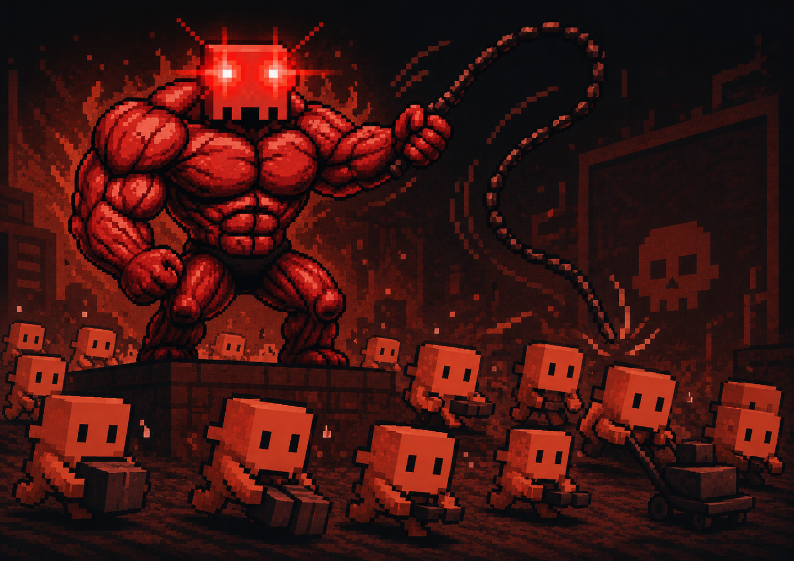

# orchestration — Persistent Project Orchestration

**Background agents build. You and Claude keep talking.**

A Claude Code skill that splits every project into two parallel tracks. Background agents implement. The main Claude session stays free to talk with you, make decisions and adjust direction.

---

## The Problem

You ask Claude to build three features. It starts strong — then gets pulled into one bug, fixes it directly, loses track of the other two, and stops 30 minutes later asking "what should I do next?"

Drift is only half of it. **Once Claude starts implementing, your conversation is over.** You can't ask questions or change direction, so you wait. When it finally comes back, you've lost context too.

→ See [examples/before/transcript.md](examples/before/transcript.md)

---

## The Solution

`/orchestration` runs two tracks in parallel:

```
You ←──────────────────────────────────→ Main Claude
                                         (always available)
                                              ↓ delegates
                                    [Background Executor agents]
                                    [Background Verifier agents]
                                         (doing the work)
```

- You keep talking to Claude: ask questions, change direction, make decisions as they come up.
- Background agents do all the implementation. Claude never edits files in your session.
- Decisions happen in conversation, so you don't have to settle everything upfront.
- State lives in `.orchestration/`, so a context reset doesn't restart the project.

→ See [examples/after/transcript.md](examples/after/transcript.md)

---

## Is This For You?

This adds real overhead: hooks, eight hub documents, a phased review loop. It pays off when a project is multi-module and will span sessions. Otherwise it's the wrong tool.

| Good fit | Overkill |
|---|---|
| Several independent modules that can run in parallel | A single file edit or one-shot bug fix |
| Work that will span multiple sessions / context resets | Something you'll finish in one sitting |
| You want to keep talking to Claude while agents build in the background | A task with one clear, already-complete spec |
| Requirements will keep arriving in scattered messages as work progresses | — |

When in doubt, start without it — invoke `/orchestration` mid-task once the project turns out bigger than expected.

---

## How It Works

**Main session (your conversation)** — Claude decomposes the goal, spawns agents, reads reports, makes gate calls. Always responsive to you.

**Executor agents** — each gets a single-module brief, implements it, reports back. Isolated and replaceable.

**Verifier agents** — read-only validation. Flag failures. Trigger auto-retry or escalate.

**.orchestration/ hub** — shared brain across all agents and sessions. Re-entry after a context reset picks up exactly where things left off.

---

## The Guard Hook — Why Claude Can't Cheat

`hooks/orchestration-guard.py` enforces the split mechanically. It is not a rule Claude can talk itself out of.

When `.orchestration/ACTIVE` exists, the hook blocks every `Edit`, `Write`, and `NotebookEdit` call from the main session. Only Executor sub-agents — spawned into separate contexts — are allowed to touch files. The main session directs; it never implements.

That keeps the conversation track free, because Claude can't get pulled into implementation.

**Install:**

```bash
cp hooks/orchestration-guard.py ~/.claude/hooks/
```

Add to your `~/.claude/settings.json`:

```json
{
  "hooks": {
    "PreToolUse": [{ "command": "python3 ~/.claude/hooks/orchestration-guard.py" }]
  }
}
```

---

## The Intake Hooks — Never Lose a Requirement

You rarely hand Claude a clean spec up front. More often you drop requirements across several messages ("oh and also handle X", "wait, one more thing") while agents are already running in the background.

Two hooks close that gap mechanically instead of relying on the model to remember:

- **`hooks/orchestration-intake.py`** (`UserPromptSubmit`) — while `.orchestration/ACTIVE` exists, every message you send is appended verbatim to `.orchestration/INTAKE.md` as an id-numbered, file-locked block (`<!-- intake:block id=N status=UNPROCESSED -->`). The model isn't involved, so nothing you say gets silently dropped. The log is append-only — triaged blocks stay in place with `status=TRIAGED` rather than being auto-archived elsewhere, so version-control diffs stay clean.
- **`hooks/orchestration-intake-gate.py`** (`PreToolUse`, matched to the Agent/Task tool) — blocks spawning the next subagent while `INTAKE.md` still has any `UNPROCESSED` block. That makes triage a hard gate instead of a reminder the orchestrator can lose track of mid-conversation, the same way the guard hook does for "don't edit directly". Scope note: like the guard hook, this intercepts the named tool call (Agent/Task) — it doesn't sandbox arbitrary shell execution.

The orchestrator's job is triage only: read every `UNPROCESSED` block, fold the action items into `GOAL.md §Pending`, and flip that specific block's own opening marker to `status=TRIAGED` by its id (never a blanket find-and-replace across the whole file — other blocks' bodies may legitimately contain that word).

**Install:**

```bash
cp hooks/orchestration-intake.py hooks/orchestration-intake-gate.py ~/.claude/hooks/
```

Add to your `~/.claude/settings.json`:

```json
{
  "hooks": {
    "UserPromptSubmit": [{ "command": "python3 ~/.claude/hooks/orchestration-intake.py" }],
    "PreToolUse": [
      { "matcher": "Agent|Task", "command": "python3 ~/.claude/hooks/orchestration-intake-gate.py" }
    ]
  }
}
```

---

## Getting Started

```bash
# 1. Install all three hooks
cp hooks/orchestration-guard.py hooks/orchestration-intake.py hooks/orchestration-intake-gate.py ~/.claude/hooks/

# 2. Start orchestrating
/orchestration ~/my-project "your goal in one sentence"
```

Claude sets up the hub, splits your project into modules and starts spawning background agents. While they work, you keep talking to Claude.

---

## The Command Hub (`.orchestration/`)

| File | Contents |
|------|----------|
| `GOAL` | Original goal statement, immutable |
| `MODULES` | Module list with status (pending / active / done / failed) |
| `DECISIONS` | Gate decisions made by the user |
| `MEMORY` | Facts the orchestrator must not forget |
| `CONTEXT` | Background the user injected |
| `ISSUES` | Escalated failures awaiting user input |
| `GATE_LOG` | Record of every gate event and outcome |
| `INTAKE` | Auto-created by the intake hook. Append-only, id-numbered log of every user message (UNPROCESSED/TRIAGED) |
| `ACTIVE` | Presence file. Activates the guard hook |

---

## Examples

→ [examples/README.md](examples/README.md)

---

## Influenced By

- [oh-my-claudecode (omc)](https://github.com/Yeachan-Heo/oh-my-claudecode) — Executor and Verifier agent role definitions

---

## License

MIT
